# Фінальний DevOps STEP-проєкт

## Опис проєкту

Цей проєкт демонструє повний процес CI/CD та GitOps для автоматичного розгортання Python вебзастосунку в Kubernetes-кластері Amazon EKS.

Інфраструктура AWS створюється та керується за допомогою Terraform.

GitHub Actions автоматично збирає Docker-образ застосунку та завантажує його до Docker Hub.

ArgoCD відстежує зміни Kubernetes-маніфестів у GitHub та автоматично оновлює застосунок у кластері EKS.

Доступ до застосунку та вебінтерфейсу ArgoCD організовано через AWS Application Load Balancer із використанням HTTPS.

## Використані технології

- **AWS** — хмарна інфраструктура.
- **Terraform** — автоматичне створення інфраструктури (Infrastructure as Code).
- **Amazon EKS** — керований Kubernetes-кластер.
- **Docker** — контейнеризація Python-застосунку.
- **Docker Hub** — зберігання Docker-образів.
- **GitHub Actions** — автоматична збірка та публікація Docker-образів.
- **ArgoCD** — автоматичне розгортання через GitOps.
- **Kubernetes** — керування контейнерами.
- **AWS Load Balancer Controller** — створення та керування AWS ALB через Kubernetes Ingress.
- **AWS Certificate Manager (ACM)** — SSL/TLS-сертифікат для HTTPS.
- **Python** — вебзастосунок.


## Архітектура проєкту

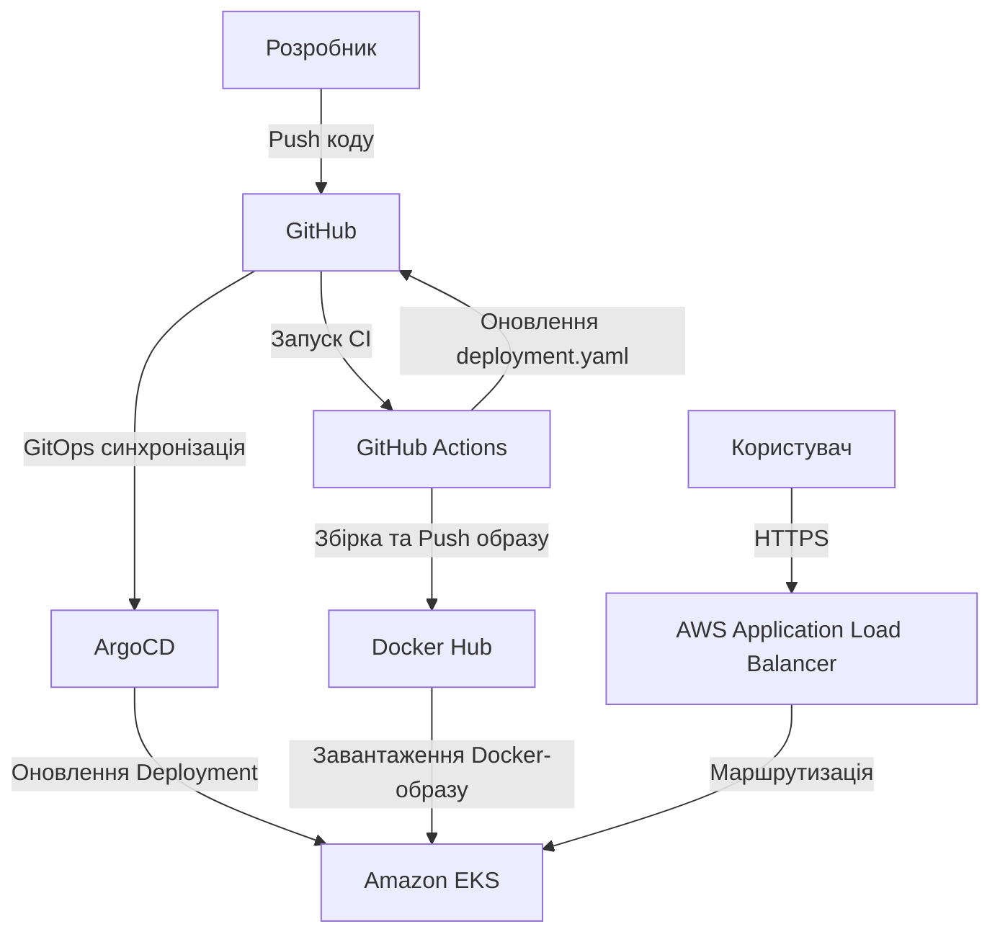

### Як працює система

1. Розробник змінює Python-код і відправляє його до GitHub.
2. GitHub Actions автоматично збирає новий Docker-образ.
3. Образ публікується в Docker Hub.
4. GitHub Actions оновлює тег образу в `deployment.yaml` та зберігає зміну в GitHub.
5. ArgoCD виявляє зміну маніфесту та синхронізує Kubernetes Deployment.
6. Kubernetes завантажує новий образ і оновлює Pod-и застосунку.
7. Користувач відкриває застосунок через HTTPS, а AWS ALB направляє запит до Kubernetes.


## Структура проєкту

```text
Final_step_project/
├── app/
│   ├── app.py                  # Python вебзастосунок
│   └── Dockerfile              # Збірка Docker-образу
│
├── argocd/
│   ├── main.tf                 # Встановлення ArgoCD через Helm
│   ├── providers.tf            # Провайдери Terraform
│   ├── versions.tf             # Версії провайдерів
│   ├── load_balancer_controller.tf # AWS Load Balancer Controller
│   └── ingress.yaml            # HTTPS-доступ до ArgoCD
│
├── envr/
│   ├── main.tf                 # Основна AWS-інфраструктура
│   ├── variables.tf            # Змінні Terraform
│   ├── versions.tf             # Конфігурація Terraform
│   └── terraform.tfvars        # Значення змінних (локально)
│
├── k8s/
│   ├── application.yaml        # ArgoCD Application
│   ├── deployment.yaml         # Kubernetes Deployment
│   ├── service.yaml            # Kubernetes Service
│   └── ingress.yaml            # HTTPS-доступ до застосунку
│
├── modules/
│   ├── eks/                    # Terraform-модуль Amazon EKS та IAM
│   └── network/                # VPC, підмережі, маршрутизація, NAT
│
├── screens/                    # Скриншоти роботи проєкту
├── iam-policy.json             # IAM-права AWS Load Balancer Controller
└── README.md                   # Документація проєкту
```

### Основні компоненти

**app/** — вихідний код Python-застосунку та Dockerfile для створення контейнерного образу.

**envr/** — основна конфігурація Terraform, яка створює мережеву інфраструктуру AWS та кластер Amazon EKS.

**modules/** — окремі Terraform-модулі для мережі, Kubernetes-кластера та IAM.

**argocd/** — Terraform-конфігурація встановлення ArgoCD та AWS Load Balancer Controller через Helm, а також Ingress для ArgoCD.

**k8s/** — Kubernetes-маніфести для запуску застосунку та його автоматичного розгортання через ArgoCD.

**screens/** — скриншоти, які підтверджують роботу застосунку та інфраструктури.


## CI/CD та GitOps

У проєкті реалізовано автоматичний процес збірки та розгортання Python-застосунку за допомогою GitHub Actions, Docker Hub та ArgoCD.

### Continuous Integration (CI)

За автоматичну збірку застосунку відповідає GitHub Actions.

Workflow розташований у файлі `.github/workflows/docker-build.yml` у корені Git-репозиторію.

Після Push змін у коді застосунку:

1. GitHub Actions запускає CI workflow.
2. Завантажує вихідний код із GitHub.
3. Авторизується в Docker Hub за допомогою GitHub Secrets.
4. Збирає новий Docker-образ із Dockerfile.
5. Публікує образ у Docker Hub із тегами `latest` та SHA коміту.
6. Оновлює тег Docker-образу у файлі `k8s/deployment.yaml`.
7. Створює коміт зі зміненим Kubernetes-маніфестом і відправляє його до GitHub.

### Continuous Deployment (CD)

За автоматичне розгортання застосунку відповідає ArgoCD.

1. ArgoCD відстежує папку `Final_step_project/k8s/` у GitHub.
2. Виявляє зміну Docker-образу в `deployment.yaml`.
3. Автоматично синхронізує Kubernetes-ресурси.
4. Kubernetes завантажує новий Docker-образ із Docker Hub.
5. Створюються нові Pod-и з оновленою версією застосунку.
6. Застосунок стає доступним через AWS Application Load Balancer.

### GitOps

У проєкті використовується підхід GitOps.

GitHub є джерелом бажаного стану Kubernetes-ресурсів.

ArgoCD порівнює конфігурацію в GitHub із фактичним станом кластера та автоматично застосовує необхідні зміни.

Завдяки цьому для оновлення застосунку не потрібно вручну виконувати `kubectl apply`.

### Перевірка роботи CI/CD

Автоматичне оновлення було перевірено на практиці:

- Змінено відповідь Python-застосунку з `Hello from CI/CD v2!` на `Hello from CI/CD v3!`.
- Зміни відправлено до GitHub.
- GitHub Actions зібрав і опублікував новий Docker-образ.
- ArgoCD автоматично синхронізував нову версію.
- Застосунок почав повертати `Hello from CI/CD v3!`.
- ArgoCD показав стан `Synced` та `Healthy`.


## AWS-інфраструктура

Інфраструктура проєкту створюється за допомогою Terraform у регіоні AWS `eu-central-1` (Frankfurt).

Terraform-конфігурація розділена на модулі для зручного керування мережею, Kubernetes-кластером та IAM.

### Мережева інфраструктура (VPC)

Для розміщення Kubernetes-кластера створюється окрема VPC.

- **VPC CIDR:** `192.168.0.0/20`
- **Public Subnet A:** `192.168.1.0/24`
- **Public Subnet B:** `192.168.2.0/24`
- **Private Subnet A:** `192.168.3.0/24`
- **Private Subnet B:** `192.168.4.0/24`

Мережева інфраструктура включає:

- **Internet Gateway (IGW)** — забезпечує доступ до інтернету для ресурсів у публічних підмережах за відповідної маршрутизації.
- **NAT Gateway** — забезпечує вихідний доступ до інтернету для ресурсів у приватних підмережах.
- **Route Tables** — визначають маршрути мережевого трафіку.
- **Public Subnets** — використовуються для публічних мережевих ресурсів.
- **Private Subnets** — використовуються для робочих вузлів Amazon EKS.

### Amazon EKS

Для запуску застосунку використовується керований Kubernetes-кластер Amazon EKS.

Параметри кластера:

- **Назва:** `student-denys`
- **Регіон:** `eu-central-1`
- **Node Group:** одна група робочих вузлів
- **Кількість вузлів:** 1
- **Тип EC2:** `c7i-flex.large`
- **Розміщення вузлів:** приватні підмережі VPC

Amazon EKS керує Kubernetes Control Plane, а робочий вузол EC2 запускає Pod-и застосунку та системних компонентів.

### IAM та OIDC

Для безпечної взаємодії Kubernetes із сервісами AWS використовуються IAM Roles та OIDC.

Terraform створює IAM Role для AWS Load Balancer Controller і налаштовує Trust Policy для Kubernetes ServiceAccount.

Це дозволяє контролеру отримувати тимчасові AWS-облікові дані без зберігання статичних Access Keys у Pod-ах.

### AWS Load Balancer Controller

AWS Load Balancer Controller встановлюється через Helm за допомогою Terraform.

Контролер обробляє Kubernetes Ingress-ресурси та керує AWS Application Load Balancer.

Через ALB забезпечується доступ до:

- Python-застосунку.
- Вебінтерфейсу ArgoCD.

Для обох сервісів використовується HTTPS із сертифікатом AWS Certificate Manager (ACM).

### Terraform State

Terraform State використовується для відстеження створених ресурсів.

- Основна AWS-інфраструктура використовує віддалений Terraform Backend в Amazon S3.
- Конфігурація встановлення ArgoCD та AWS Load Balancer Controller використовує окремий локальний Terraform State.

Файли Terraform State не зберігаються в GitHub, оскільки можуть містити конфіденційні дані.


## Результати роботи проєкту

### Доступ до сервісів

**Python-застосунок:**

https://app.jimbo-devops.pp.ua

**ArgoCD:**

https://argocd.jimbo-devops.pp.ua

Для обох сервісів налаштовано HTTPS через AWS Application Load Balancer та сертифікат AWS Certificate Manager.

DNS-записи домену налаштовуються вручну через NIC.UA.

> **Примітка:** AWS-інфраструктура може бути тимчасово вимкнена або видалена для уникнення витрат. У такому випадку наведені адреси будуть недоступні до повторного розгортання інфраструктури.

### Скриншоти

#### 1. Робота Python-застосунку через HTTPS

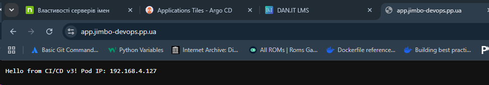

#### 2. Локальна перевірка застосунку

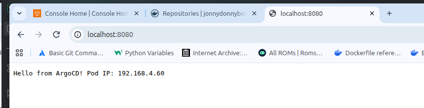

#### 3. Вебінтерфейс ArgoCD

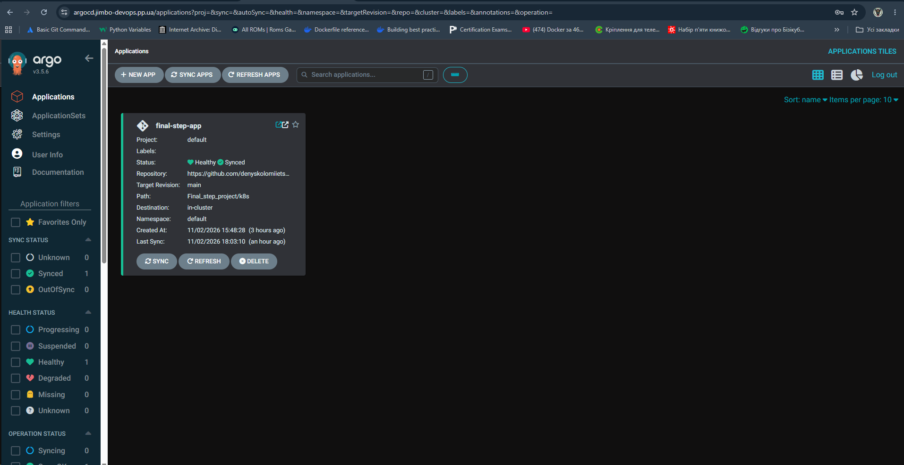

#### 4. Структура проєкту

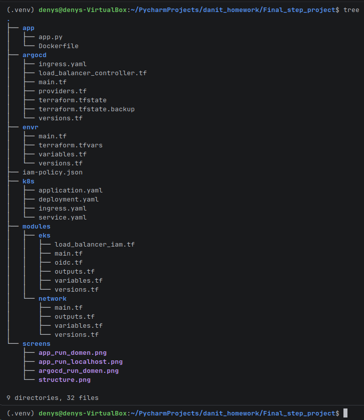


#### 5. Amazon EKS — стан кластера

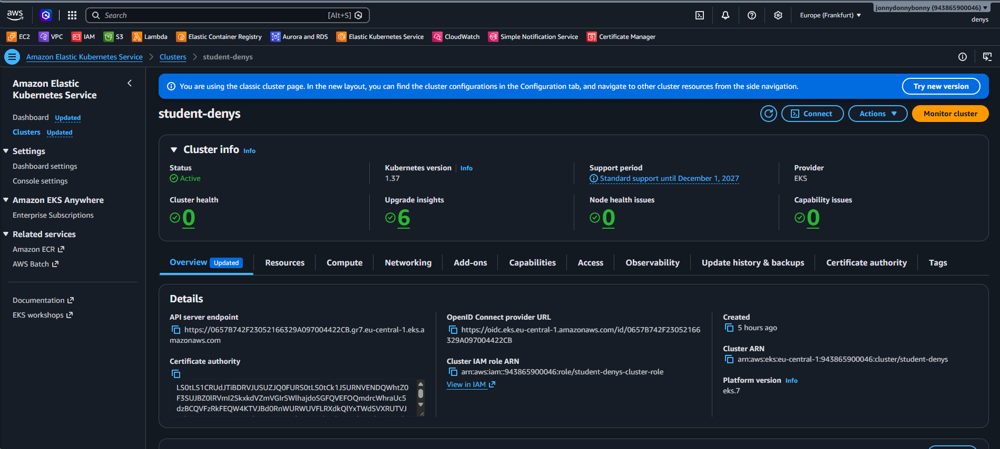

#### 6. Amazon EKS — робочий вузол

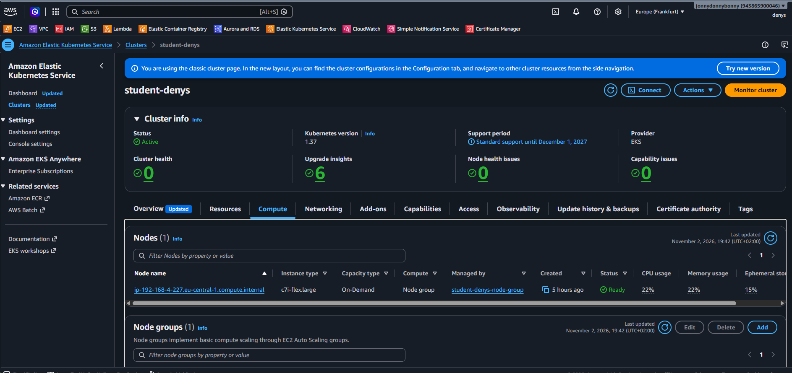

#### 7. Kubernetes — Namespaces

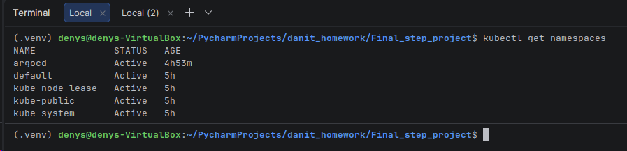

#### 8. Kubernetes — Pod-и

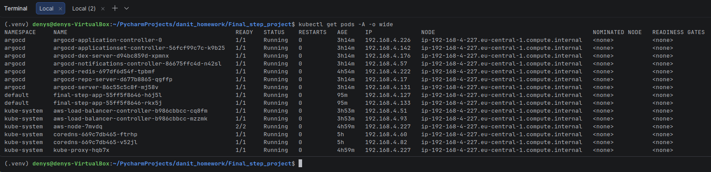

#### 9. Kubernetes — Deployment, Service та Ingress

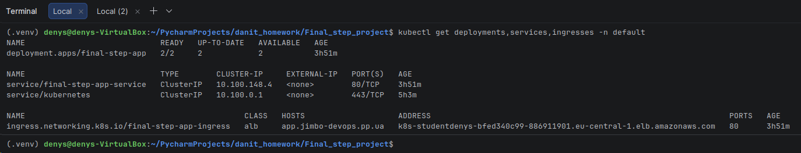

#### 10. ArgoCD — дерево ресурсів

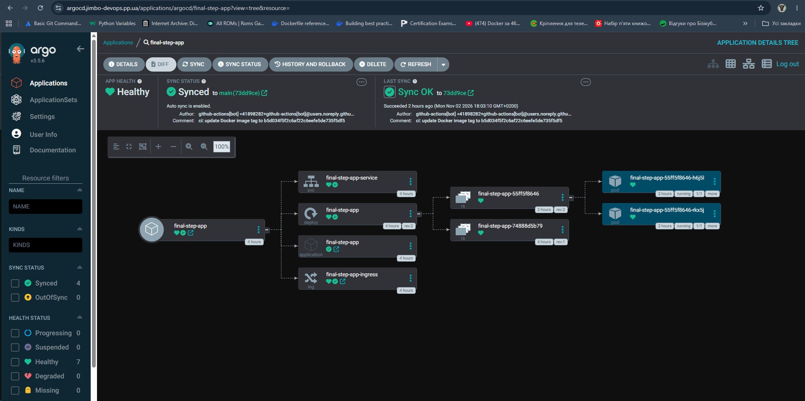

#### 11. ArgoCD — конфігурація Application

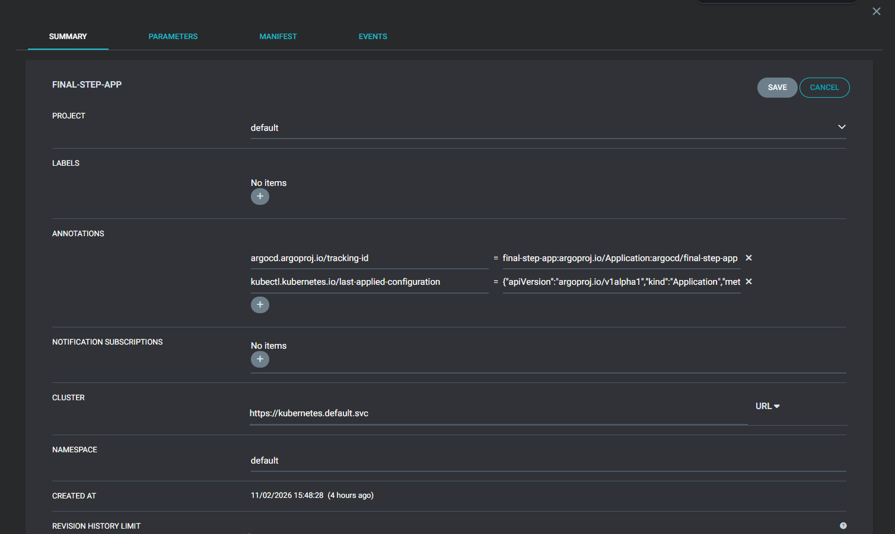

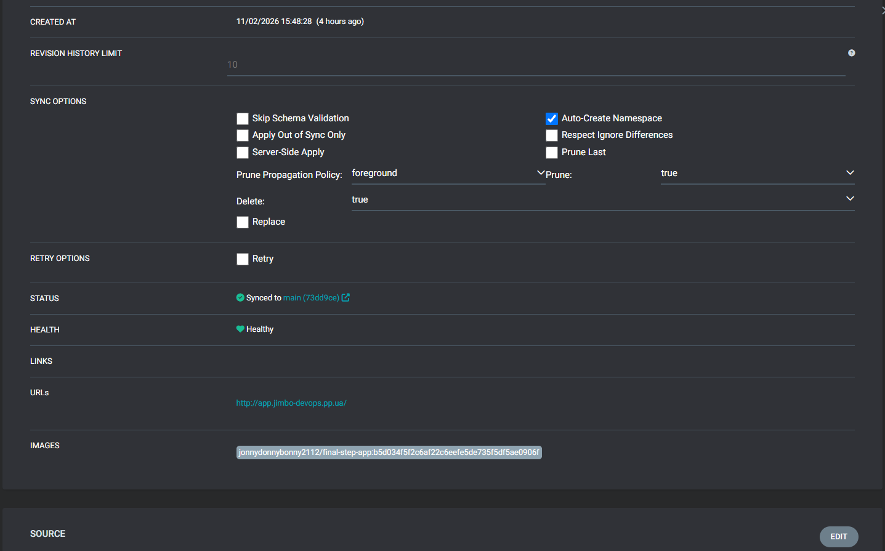

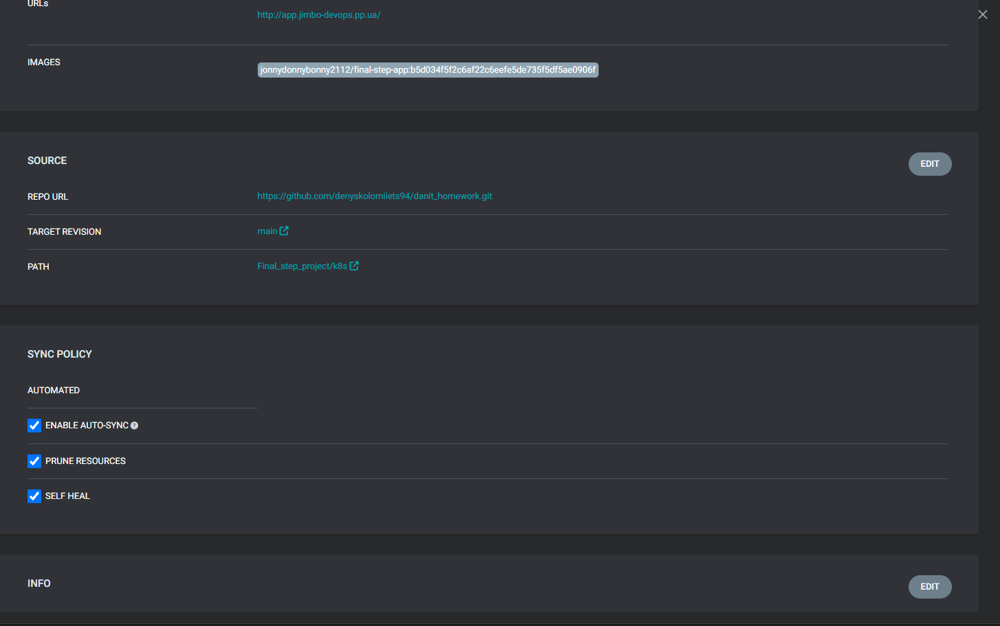

#### 12. Docker Hub — історія Docker-образів

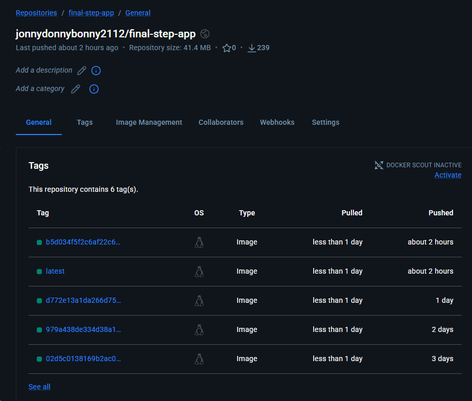

#### 13. GitHub Actions — історія запусків

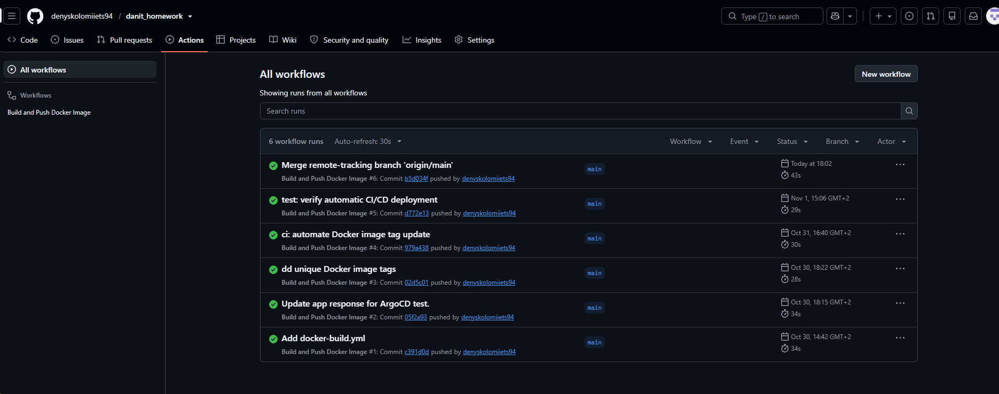

#### 14. GitHub Actions — етапи CI/CD

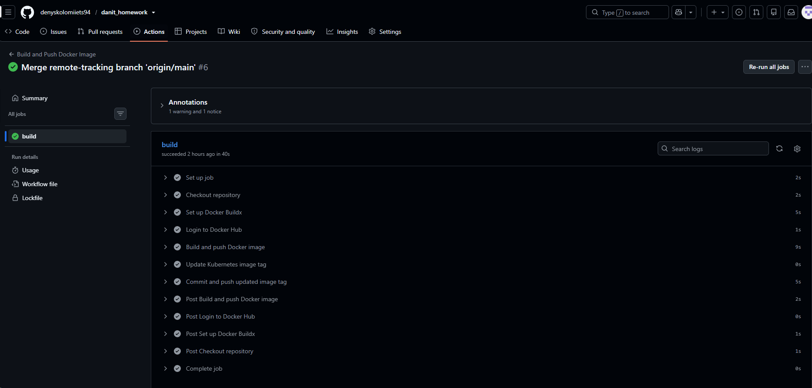


### Підсумок

У результаті виконання проєкту реалізовано:

- Автоматичне створення AWS-інфраструктури через Terraform.
- Kubernetes-кластер Amazon EKS із робочим вузлом у приватній підмережі.
- Контейнеризацію Python-застосунку за допомогою Docker.
- Автоматичну збірку та публікацію Docker-образів через GitHub Actions.
- Автоматичне розгортання застосунку через ArgoCD.
- Публічний HTTPS-доступ через AWS Application Load Balancer.
- Повний CI/CD процес від зміни Python-коду до оновлення застосунку в Kubernetes.
